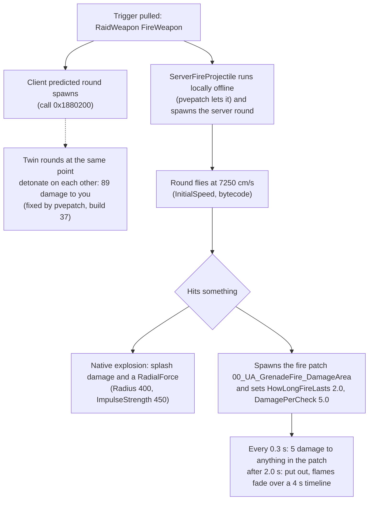
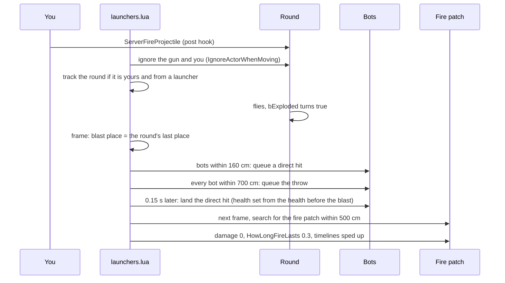

# 40mm launchers: the round, the blast, the fire

The Mini Thumper and the China Lake both fire the same projectile, `Proj40mm` (Blueprint `/Game/Blueprints/Weapons/Proj40mm`).
This file covers what happens from the trigger to the last flame, what the mod changes (`launchers.lua`, plus a few hooks in
`botdamage.lua`), the numbers, and what is still not understood. Facts are tagged: **bytecode** (read from the Blueprint),
**measured** (seen in the running game), **guess** (marked).

Code: `mods/PvEDirector/Scripts/launchers.lua`. Test tool: `tools/launcher_test/`. Research log: NOTES.md, "40mm round explodes in
your hands (#360)" and "40mm launcher blast (2026-11-25)".

## What the game does

- The explosion damage and radius are native (`bDoesExplode`, `SelfExplode`); they are not in the Blueprint.
- The fire patch's own defaults are `HowLongFireLasts` 25, `DamagePerCheck` 6, `FireAreaCheckLoopTimer` 0.3 (bytecode). The round
  overwrites the first two after spawning the patch: 2.0 and 5.0 (bytecode, in the round's spawn sequence).
- The patch's timelines (measured, from the log): `FireTurnOff` 1.00 s, `DecalSizeScale` 1.49 s, `Timeline_0` 0.69 s, `Timeline_1` 5.00 s.
- Both launchers use the same round and the same fire patch. Rounds are pooled (`PooledProjectile`): the pool builds them once.

## What the mod changes

1. **Barrel burst (#360).** After `ServerFireProjectile` the new round's collision ignores the gun and you (build 37). The twin round is
   skipped by `pvepatch.dll`. Both were already in build 37 and are unchanged.
2. **Direct hit.** A round that goes off within 160 cm of a bot's middle takes a share of the bot's health before the blast
   (the health sampled one and two frames earlier, so the game's own splash does not count twice):

   | Launcher | Share of health | Result on a bot with no armour |
   | --- | --- | --- |
   | China Lake | 150 percent | dead |
   | Mini Thumper | 90 percent | left with 10 percent |

   Armour takes 5 percent off the share per point of the body rating (`ARMOUR_SHARE` 0.05; the helmet is not used). A vest of
   13 takes 65 percent off, so a China Lake leaves the bot about half its health and the Thumper about two thirds. A China Lake
   still kills through a rating of 6 or less. The bot ends up at its health from before the blast, less the take, or dead; if the
   splash already took more than that it is left alone. `MaxHealth` is not a plain number on a bot (it reads as an object), so
   the share is of the current health, not the maximum.
3. **Throw.** A bot still on its feet is left alone, as the game has it. A bot that is dead or ragdolled within 1.7 s of the blast
   gets a flat push of `DEAD_THROW` (513 cm/s, falling with distance to a floor of 30 percent) on all its bodies, which slides it about
   2.5 m. `botdamage.lua` carries it (`B.throw(bot, v, live, dead)`): `live` 0 skips the launch of a bot on its feet, `dead` replaces
   the throw of a ragdoll.
4. **Fire.** The patch within 500 cm of a blast does no damage, burns one check (0.3 s) and its timelines are sped up so the whole
   flash lasts about 0.6 s (`FireTurnOff` to 0.3 s, the others to 0.3 s). Only patches near one of your blasts are touched, so
   the incendiary grenade is not changed, and a rival's launcher keeps the game's fire.

### Numbers (all at the top of `launchers.lua`)

| Name | Value | Meaning |
| --- | --- | --- |
| `DIRECT` | China Lake 1.5, Mini Thumper 0.9 | Direct hit as a share of the bot's health before armour |
| `DIRECT_RADIUS` | 160 cm | How close to a bot's middle counts as a direct hit |
| `ARMOUR_SHARE` | 0.05 | Share of the direct hit each point of body armour takes off |
| `BLAST_RADIUS` | 700 cm | Bots this close are thrown (when dead) |
| `DEAD_THROW` | 513 cm/s | Flat speed of the push on a dead bot |
| `FIRE_DAMAGE`, `FIRE_BURN`, `FIRE_FADE`, `FIRE_GROW` | 0, 0.3 s, 0.3 s, 0.3 s | The fire patch |

## Tested in game (2026-11-25, offline, Spaceport_01)

- China Lake, no armour: bot dead. Armour 13: 200 to 95 health. The log line is `launchers: China Lake direct hit on ...`.
- Mini Thumper, no armour: 200 health left at 20.
- Dead bots slide about 2.5 m after the nudge (the first value, 380, was judged a little short and raised 35 percent).
- The fire flash looks right and does no damage. The first version used `NotifyOnNewObject` on the patch class, which never fired in
  a fresh session (the class is not loaded when the mod starts); it only worked after a hot reload. It is now found with
  `FindAllOf` once the frame after a blast.

Not tested: the Mini Thumper against armour, rival crews firing launchers, flare and dart guns, what a patch does when
two blasts overlap.

## Not understood: the China Lake going off at the muzzle while walking

In some sessions a China Lake round went off about 87 cm in front of you (roughly 40 cm up) within 0.01 s when you were walking or
sprinting. At speed 0 it flew normally; the Mini Thumper never did it. A trace from the round's place along its path found nothing
within 250 cm and no wall. Two attempts to stop it:

- Collision off for the round's first 0.03 s: it flew, but a wall closer than about 2 m was passed through.
- Overlap events off for the first 0.15 s: no muzzle burst, but rounds stopped hitting walls at all (walls are hit through overlap).

Both were taken out. The burst was seen only in sessions where `launchers.lua` had been hot reloaded one or more times (each
reload adds one more copy of the post hook, and UE4SS cannot remove one); in a clean session it did not come back in several minutes
of walking shots. Treat hot reloading of this module as unsafe (the old copies still run their `afterFire`), and if the burst is
seen in a clean session, start from the log lines in NOTES.md.

Also learned the hard way: reading every property of a live round (`ForEachProperty` with a value read each) crashed the game at once.
Use method calls (`GetCollisionResponseToChannel` and friends) and `LineTraceSingle` through `outref.lua`.

## Test tool

`tools/launcher_test/` fires both launchers by itself, hip and aimed, and writes one line per shot: how many rounds left the gun, your
health before and after, and when the round went off. See its README. It is for test installs only, and it has not been run in game yet (syntax checked only).
