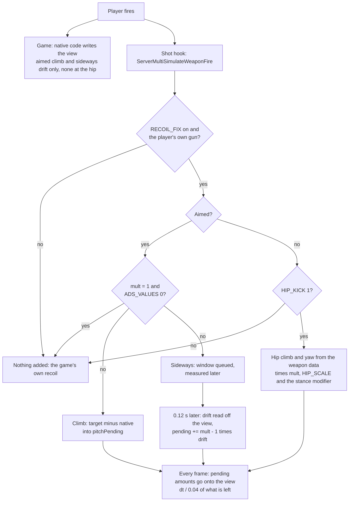
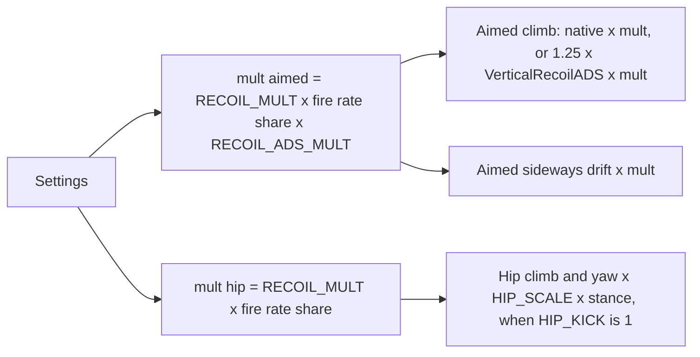

# Recoil reference

How the game kicks the view when you fire, what it does for each gun, and how `recoil.lua` adds what the settings ask for on top. Written
2026-11-24 for issue #371 and redone 2026-11-25 on build 37. The mod code is `mods/PvEDirector/Scripts/recoil.lua`, called every frame from
`main.lua`; the measuring tool is `tools/recoil_test/`. The reasoning and the dead ends are in the NOTES.md section "Recoil as the weapon
data says".

Every statement says where it came from:

| Source | Meaning |
| --- | --- |
| Measured | Read live in game on a test install with tools/recoil_test (the view's pitch every frame while shots were fired at a wall). |
| Hooked | Seen by hooking a function and logging when it fired. |
| Guess | Inferred, not shown. Marked so nobody builds on it by accident. |

## What the game does (recoil.lua switched off)

Measured on all 28 automatic guns, 14 single shot guns and 9 pistols, 5 shots each, aimed then hip, view left free.

1. At the hip the game gives the view no kick at all, on every gun, whatever its `VerticalRecoil`. (Measured)
2. Aimed, the view climbs by a fixed figure for each gun, the same on every shot, whatever the mouse does. The game never reads
   `VerticalRecoilADS` (the Jackhammer, 0.3 aimed against 2.0 at the hip, kicks like a 2.0 gun). (Measured)
3. One point of `VerticalRecoil` is 1.25 degrees of climb. On every automatic gun, and on the Welrod, SPP 1, Obrez, De Lisle, Terminator
   and Jackhammer, the aimed climb is 1.25 * `VerticalRecoil`. (Measured)
4. On the other single shot guns and pistols it is a lower fixed figure, one per gun (the table below). Earlier notes called
   these guns "weak" or "different every shot"; that was measured with an earlier version of the fix running and by hand clicking, and
   the clean runs do not show it. (Measured)
5. `recoilModifier.Aiming` is not applied to the view (the Welrod keeps exactly 1.25 * 3.0 = 3.75 with its 6.0). (Measured)
6. `currentRecoil` and `currentBulletSpread` stay 0.0 offline, so they cannot be read as the recoil or the bloom. The native code writes
   the view's rotation directly, so there is nothing to hook before it. (Measured, Hooked)
7. The live `WeaponConfig` of every gun equals the pak data. (Measured)
8. Aimed shots also drift sideways on their own, a random figure on every shot: the automatics (a few tenths of a degree a shot, up to
   2.7 on the Krasa), the M16, the Custom Mat 49 and the Terminator, and nothing on the other single shots and pistols. It does not follow
   `HorizontalRecoilMin..Max` in any way that can be calculated (the MG42 has 0.1 and drifts 0.6, the Jackhammer once drifted 8 degrees),
   so it cannot be taken from the weapon data, only read off the view. At the hip there is none. (Measured)
9. The climb does not depend on how fast you fire. Singles clicked 0.74 s apart and as fast as the game allows give the same climb a shot, and
   so do the automatics at 30 to 975 rpm. All 51 guns have `NoRecoilRecovery` true, so `RecoilRecoveryDelay` and `RecoilRecoveryRate` are
   never used and nothing resets between shots; `RecoilBlendSpeed` (1 to 64) only sets how fast a kick lands. The one exception found is the
   Trench Shotgun (see "Firing fast against slow"). (Measured)

The guns that do not climb 1.25 * `VerticalRecoil` a shot. `NATIVE` in recoil.lua holds one factor per gun, degrees of climb per point of
`VerticalRecoil` (1.25 for the guns not listed here, so a factor of 0.2544 is a fifth of the usual 1.25):

| Gun | Class | Vertical | Factor | Aimed climb a shot |
| --- | --- | --- | --- | --- |
| Reising | `Rifle_M50reising_Child_C` | 2.00 | 0.4014 | 0.80 |
| Johnson | `Rifle_Johnson_Child_C` | 4.00 | 0.7633 | 3.05 |
| SVT 40 | `Rifle_SVT40_Child_C` | 2.75 | 0.2544 | 0.70 |
| M1 Carbine Para | `Rifle_M1_Para_Child_C` | 1.50 | 0.2543 | 0.38 |
| MAS 44 | `Rifle_Mas44_Child_C` | 3.00 | 0.2544 | 0.76 |
| AC14 | `Rifle_AC14_Child_C` | 2.20 | 0.2543 | 0.56 |
| Liberator, Heavy Liberator | `Shotgun_Liberator_Child_C`, `Shotgun_HeavyLiberator_Child_C` | 2.50 | 0.1032 | 0.26 |
| Trench gun | `Shotgun_TrenchGun_Child_C` | 6.50 | 0.7173 | 4.66 |
| Double barrel | `Shotgun_LongDouble_Child_C` | 2.50 | 0.3096 | 0.77 |
| Sawed off | `Shotgun_SawedOffDouble_Child_C` | 3.00 | 0.322 | 0.97 |
| M1911, M1911 G | `Pistol_1911_Child_C`, `Pistol_1911_G_Child_C` | 2.50 | 0.1541 | 0.39 |
| Luger P08 | `Pistol_P08_Child_C` | 2.00 | 0.2544 | 0.51 |
| Webley | `Pistol_Webley_Child_C` | 4.00 | 0.2544 | 1.02 |
| M712 pistol | `Pistol_M712_Child_C` | 2.25 | 0.026 | 0.06 |
| M712 Special | `Rifle_M712_Special_Child_C` | 2.25 | 0.838 | About 1.9. Its kick lands slowly and varies shot to shot (1.8, 1.8, 2.0, 2.3), so the factor is a mean. (Guess) |

Every other automatic gun, shotgun and pistol in the set climbs 1.25 * `VerticalRecoil`. A gun that is not in the table is measured instead (see below).
Muzzle and stock attachments add their own `VerticalRecoilAdjustment` to the gun's vertical value (getter 0x188a260, read from the game by
#453); the native climb follows it, and so does the target here. Not tested in game with attachments. (Guess)

## What recoil.lua does

It hooks `RaidWeapon:ServerMultiSimulateWeaponFire`, registered lazily on the first frame of a raid, and acts only on shots of the player's
pawn. D is 1.25 degrees per point. `native` is the game's own aimed climb for that gun (`NATIVE`, times the attachment adjustment). Every
shot adds, in degrees:

| Shot | What the shot ends up at | Added to the view |
| --- | --- | --- |
| Aimed, `ADS_VALUES` 0 | `native * mult` | `native * mult - native` |
| Aimed, `ADS_VALUES` 1 | `D * VerticalRecoilADS * mult` | that minus `native` |
| Hip, `HIP_KICK` 1 | `D * VerticalRecoil * mult * HIP_SCALE * state` | all of it, plus a yaw of `HorizontalRecoilMin..Max` times the same factor |
| Hip, `HIP_KICK` 0 | nothing (the game's own) | nothing |
| Aimed, sideways | the game's own drift times `mult` | `(mult - 1)` times the drift measured over the shot's window (see below) |

`mult` is `RECOIL_MULT * fire rate share * RECOIL_ADS_MULT` aimed, and `RECOIL_MULT * fire rate share` at the hip. `state` is the product of
the weapon's `recoilModifier.Crouching` (crouched), `.Moving` (horizontal speed over 100 cm/s) and `.InAir` (falling). The fire rate share
is, for an automatic gun firing faster than `REF_INTERVAL`, `interval / REF_INTERVAL` and never below `MIN_SCALE`.

With every setting at its default (`RECOIL_MULT` 1, `RECOIL_ADS_MULT` 1, `MIN_SCALE` 1, `ADS_VALUES` 0, `HIP_KICK` 0) nothing is added at
all: the recoil is the game's own, and `RECOIL_FIX` 0 does the same. The layer adds only the difference the settings ask for. The pending
climb goes onto the view every frame at `dt / 0.04` of what is left, so a shot lands in about 0.1 seconds.

A gun that is not in `NATIVE` (a modded one) has its kick measured instead, and only when a setting asks for a change: the view's pitch,
less what recoil.lua has added, is read from 0.04 s before the hook to 0.12 s after it, and that movement is taken as the game's kick,
held between 0 and 1.5 * D * `VerticalRecoil` + 0.5 so a flick of the mouse is not taken as recoil. This was the whole aimed method in the
first version, before the clean runs showed the game's figure is fixed per gun.

The sideways drift is measured because it is random and has no figure to calculate it from. For every aimed shot, when `mult` is not 1,
the view's yaw (less what this file added) is read from 0.04 s before the hook to 0.12 s after it. The windows of a run of shots do not
overlap, so each movement is counted once. The shot then adds `(mult - 1) * drift`, so `RECOIL_MULT` 0 takes the drift out and 2 doubles it.
Two guards keep the player's own aim from being taken for recoil: the drift is capped at `1.5 + 0.1 * AngleMax` degrees a shot, and a shot is
left alone if the view was turning faster than 30 degrees a second in the 0.1 s before it. At the hip the game gives no drift, and with `HIP_KICK` 1 the
weapon data's yaw is already scaled by `mult`.

Settings (F3, "Recoil" tab, `recoil.CFG`): `RECOIL_MULT`, `RECOIL_ADS_MULT`, `REF_INTERVAL` and `MIN_SCALE` are build 36's names and keep
their saved values; `RECOIL_FIX`, `ADS_VALUES`, `HIP_KICK` and `HIP_SCALE` are added here and start off.

## How a shot flows

## Merged over build 36's recoil.lua

Build 36 (#371, #453) had its own `recoil.lua` that scaled the weapon's `WeaponConfig` recoil fields by fire rate. This file replaced it
and kept its settings and its intervals table (`TimeBetweenShots` from the value dump), plus the one time `recoil fields:` log per gun
class. `WeaponConfig` is no longer written: scaling it shrank `VerticalRecoil`, which the hip never reads, and the game ignores
`VerticalRecoilADS`. `MIN_SCALE` defaults to 1 (build 36 had 0.55): lower it to get build 36's fire rate feel.

## Checks

Run with the same test tool on 2026-11-25, raw (this file off) as the baseline. Degrees, shots 2 to 5 aimed, all 5 hip.

| Settings | Guns | Result |
| --- | --- | --- |
| Defaults | 28 automatic, 14 single, 9 pistols | Same as raw; the only differences are first shot noise (Terminator 0.2, Obrez 0.9, Sawed off 0.04) |
| `ADS_VALUES` 1, `HIP_KICK` 1, multipliers 1 | 28 automatic | Aimed 1.25 * `VerticalRecoilADS`, hip 1.25 * `VerticalRecoil`, exact |
| Same | 14 single shot | Within 0.006 |
| Same | 9 pistols | Within 0.005 (Sawed off aimed 0.04, first shot noise) |
| Same with `RECOIL_MULT` 0.5, `RECOIL_ADS_MULT` 1.5 | 28 automatic, 9 pistols | Hip 1.25 * `VerticalRecoil` * 0.5, aimed 1.25 * `VerticalRecoilADS` * 0.75, none off by more than the tolerance (the pistols' Sawed off 0.04) |

| Same with `RECOIL_MULT` 0.5, `RECOIL_ADS_MULT` 1.5 | 14 single shot | Hip 1.25 * `VerticalRecoil` * 0.5, aimed native climb times 0.75, within 0.006 except the Long Double aimed (+0.108 on shot 2, a late kick; shots 3 to 5 exact) |

| Sideways drift, `RECOIL_MULT` 0 | Aimed automatics | Checked by hand in game (the drift is gone); the measured run was not repeated |

Not run: attachments (whether the game's aimed kick on a fitted gun matches the target), the fire rate share (`MIN_SCALE` under 1) in
game, crouching and moving while aimed, bolt actions, launchers. The raw aimed climbs were measured with `ServerSetTargeting(true)`
forced by the test, not a held right mouse button. (Guess that they are the same)

## Firing fast against slow (recoil.lua off)

The question was whether the game changes its recoil with how quickly you fire. Measured on 2026-11-25 with bottomless mags: the 14 single
shot guns clicked every 0.74 s, then as fast as the game allows (about 0.24 s apart for the rifles), plus the 28 automatics held at
their own rates (30 to 975 rpm) and the pistols.

- The climb per shot is the same at every rate for the automatics, pistols and 12 of the 14 single shot guns (Johnson 3.05, SVT40 0.70,
  M1 Para 0.38, Mas44 0.76, M16 2.19 and so on, slow and fast). Over five shots the totals match to 0.01 degrees. The first and last
  window of a fast run differ only because the next kick lands inside the previous window.
- All 51 guns have `NoRecoilRecovery` true, so `RecoilRecoveryDelay` and `RecoilRecoveryRate` are not used: nothing pulls the view back
  and nothing ramps up or resets with time between shots. `RecoilBlendSpeed` only sets how fast a kick lands (1 to 64), not how big.
- Trench Shotgun is the exception: 4.66 degrees a shot at 0.74 s apart, 8.125 (the full 1.25 * `VerticalRecoil`) when fired at its own
  rate limit (0.48 s, `FireRate` 140). Both are one kick per shot; the fast one lands in three small steps within 0.01 s. `NATIVE` keeps
  the slow figure, so with a multiplier on the Trench Gun the added part is right for a slow shot and short for a rapid one. At
  defaults nothing is added, so it is the game's own either way.
- Liberator and Heavy Liberator were not clean at the fast rate (the kicks overlap the windows, or a click landed during the reload), so
  they are not resolved. The Reising matches its slow figure once the shots are paired up.

## Not covered

- The crouch and moving modifiers while aimed (the hip applies them; aimed the data has no figure for them).
- The sideways drift while aimed is scaled by measuring it (see "What recoil.lua does"), so a quick turn of the mouse just before or during a
  shot makes that shot's correction smaller or zero, and one inside the cap can be taken for drift. A gun that fires faster than the 0.16 s window
  smears each shot's drift over its neighbours; the total over a burst is right.
- The Trench Shotgun fired at its rate limit (see below) climbs more than `NATIVE` says, so a multiplier on it is short for rapid shots.
- The M712 Special's kick varies shot to shot in the game itself (slow blend), so aimed it ends within a few tenths of a degree of the target, not exactly on it.

## The test tool

`tools/recoil_test/` (a test install only, see its README). F9 "Recoil test, single shot guns" and "Recoil test, pistols": it swaps the
guns, forces aim down sights on and off, puts the view back at eye level between guns, and writes `bridge/recoil_test_single.txt` or
`bridge/recoil_test_pistols.txt`: a `CFG` line per gun (the live weapon data), the view's pitch and yaw every frame for 0.35 s around each
shot (`F` rows), the bloom of each shot (`S` rows), and a `GUN` line per gun. `summarise.py` prints the climb per shot and the bloom per
shot. The automatic guns' version (hold the button, 28 guns) is in the git history of this work. The raw baseline needs a switch that
turns recoil.lua off and a way to change settings between runs without a relaunch; both were test install only edits (a flag file
and a settings file read on every shot) and are not in the repo: with `RECOIL_FIX` 0 in the F3 tab the layer is off too.
