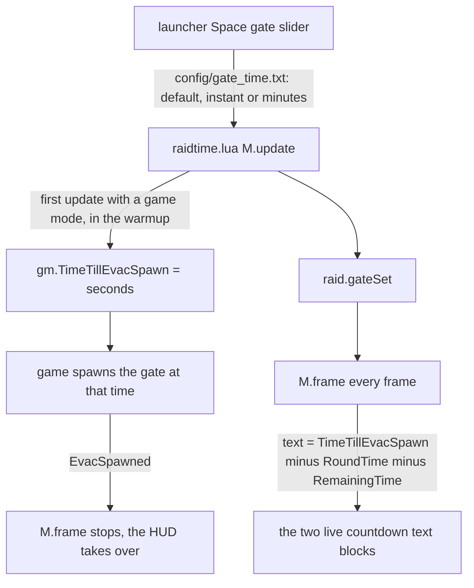

# Space gate timing reference

When the space gate (the escape gate that arrives in a space raid) comes, what the on screen countdown says, why the two
disagreed, and how the mod now lets you choose the arrival time apart from the raid length. Written 2026-11-18 from a Discord
suggestion (ChurchOfHusk_Enjoyer): the gate time should be settable, instant, 5, 10 or 15 minutes, because the custom raid
length changed the gate's countdown too. The mod code is `mods/PvEDirector/Scripts/raidtime.lua` (`M.update` sets the time,
`M.frame` writes the countdown); the setting is the launcher's "Space gate" slider, which writes `config/gate_time.txt`.

Every statement says where it came from:

| Source | Meaning |
| --- | --- |
| Measured | Read live in game on a test install (the probe runner, with read only watches). |
| Tested | Done by the mod in game and confirmed by the tester by eye. |
| Guess | Inferred, not shown. |

## What was found

1. The real gate arrives when `RaidGameMode.TimeTillEvacSpawn` seconds of the raid have gone. The stock value is 300 (5 minutes)
   whatever the raid's length. (Measured: with `RoundTime` 3600, `EvacSpawned` flipped between 296 and 311 s elapsed.)
2. The countdown on screen ("Spacegate arrives in", `Txt_SpacegateTimeArriveIn`) does not read that value. It counts to the
   point where 20 minutes of the raid are left, a fixed 20 (Measured: 34:02 beside 3243 s left, 57:37 raid clock against 37:48;
   frozen at 30:01 once the gate came). In the stock 25 minute raid the two agree (1500 minus 1200 is 300), so nobody saw it.
   With a 60 minute raid it said about 40 minutes and the gate came at 5. That is the effect the Discord post describes.
3. Writing `TimeTillEvacSpawn` during a raid does nothing: at 71 s in, a write of 600 left the spawn at 300 s. (Measured)
4. Writing it in the warmup (the first 15 s, with `RoundTime`) does move the spawn: set to 600, the gate came at 600 s
   (`EvacSpawned` false at 585 s, true at 600 s). (Measured, Tested)
5. The HUD's own widget value `EscapeGateTimeRemaining` stays 0 and is not what the text shows. (Measured)
6. Three text blocks have the countdown's name: the HUD widget's template (path `/SIGISPlugin/Widgets/HUD/...`, not on screen)
   and two live copies under the game instance. A write to the first one shows nothing. (Measured)
7. The HUD rewrites its text about once a second (20 rewrites in 10 s across the two copies). Hooks on its functions
   (`SpacegateState`, `MySlowTick`, `MyTick`, `MyFastTick`, `Tick`) registered but never fired in 6 s, so there is no hook to write
   after it. Writing every frame wins nearly all of the time. (Measured; the visible effect: Tested, "no flicker" by eye.)

## How the mod does it

- Settings: default (the game's 300 s), instant (1 s), 5, 10, 15 minutes. The file also takes any number of minutes up to 240.
- The write is once per raid (`raid.gateSet`), as soon as the game mode exists. The log says `space gate: set to arrive N s into the
  raid (...; read back ...)`, and later `space gate: countdown on 2 text blocks, showing MM:SS`.
- `M.frame` does nothing in the warmup, once the gate has spawned, or with no setting needed: for the stock raid it writes the
  same figure the HUD already shows.
- The text blocks are found by name among the TextBlocks (reading them is safe), only until they are first found. Searching again
  while a HUD is torn down was avoided on purpose: the game crashed once while live tests of this were scanning the text blocks
  (the cause was not proven; the log ends with no error).

## Test record (2026-11-18, Space raid, raid length 60, gate 10)

| Step | Result |
| --- | --- |
| Log at the start | `space gate: set to arrive 600 s into the raid (the game's own is 300 s; read back 600.0, 15 s left)` |
| Real arrival | `EvacSpawned` false at 585 s, true at 600 s |
| Countdown, not fixed | read 37:48 beside a raid clock of 57:37, then 30:01 frozen after the gate |
| Countdown, fixed (live test) | read 06:23 at 229 s, counted down in step, 00:09 at 591 s, gone when the gate spawned; no flicker seen |

## Not known

- The countdown fix was run live from a probe, not yet as the mod's own code from the launch on: the first launch with it is the
  next test.
- Instant (1 s) and 15 minutes were not run. A raid shorter than the gate time (a 15 minute raid with the gate at 15) was not run.
- "No limit" raids (timer paused) with a gate setting: not run.
- The launcher's slider was not looked at on screen (the test machine here has no Tk); the row follows the "Raid length" row.
