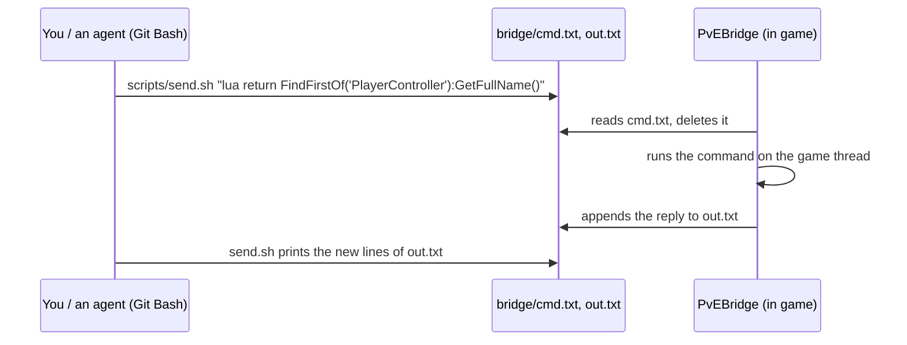

# PvEBridge: talking to the running game from outside

A small UE4SS mod for development. It loads `native/pvenet.dll` at game start (when `bridge/offline_backend` or
`bridge/capture_on` exists, so the menu's login is redirected too) and polls a command file, so scripts and AI
agents outside the game can inspect and drive it.

## Commands

| Command | What it does |
|---|---|
| `status` | World, game mode, player pawn |
| `lua <code>` | Runs a Lua chunk on the game thread; `return x` replies with x. `reply(...)` and `name(obj)` are available |
| `get <Class> <Prop>...` | Reads properties of the first live object of a class |
| `find <Class>` | Lists live objects of a class (first 40) |
| `raid <Map>`, `bot [Kind] [dist]`, `spawn <ClassPath> [dist]`, `unwidget <WidgetClass>` | Load a raid map, spawn a soldier or an actor in front of you, hide widgets |
| `dump`, `sdk`, `usmap`, `actors` | UE4SS's dumpers |
| anything else | Run as an Unreal console command |

## Careful

**A bad probe crashes the game.** Calling a method on a null or freed object faults inside UE4SS, and `pcall` can't
catch it. Check `o ~= nil and o:IsValid()` first, prefer plain property reads, and never call `GetClass()` or
`ForEachProperty` on hook parameters. Two game copies (co-op testing) each get their own folder through `PVE_BRIDGE`.
The release build ships a smaller bridge without the command loop (`tools/release/PvEBridge_main.lua`).
