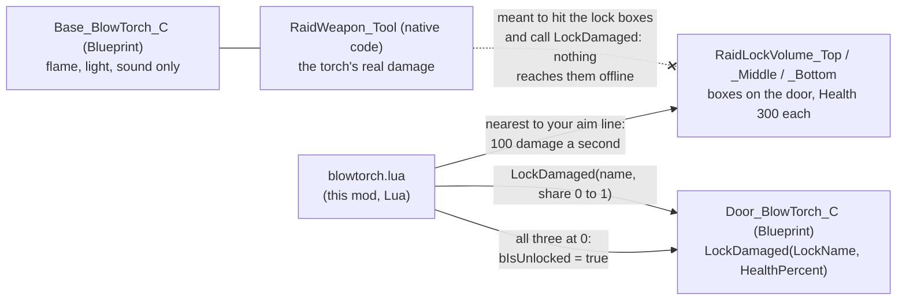
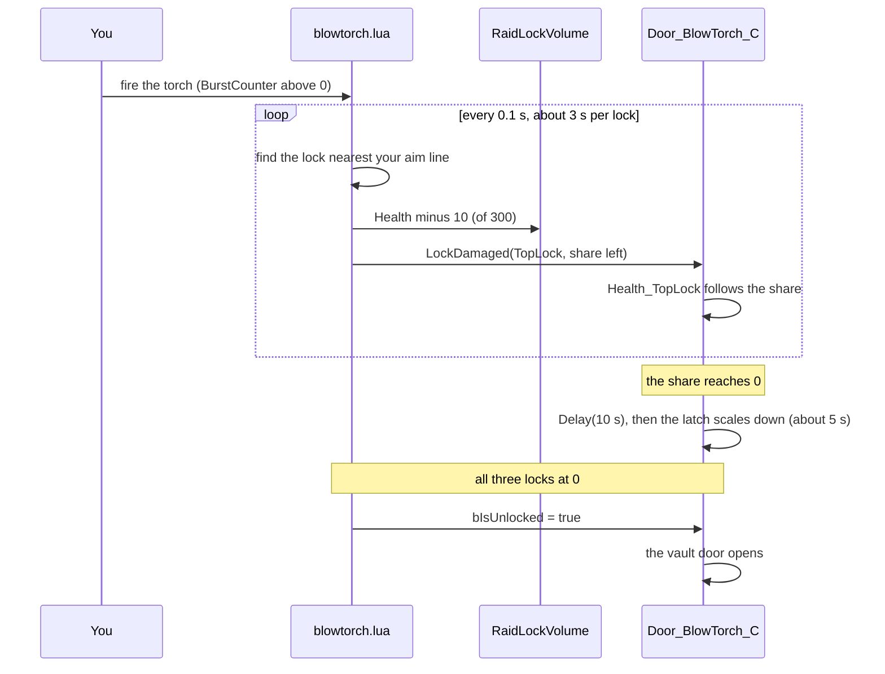
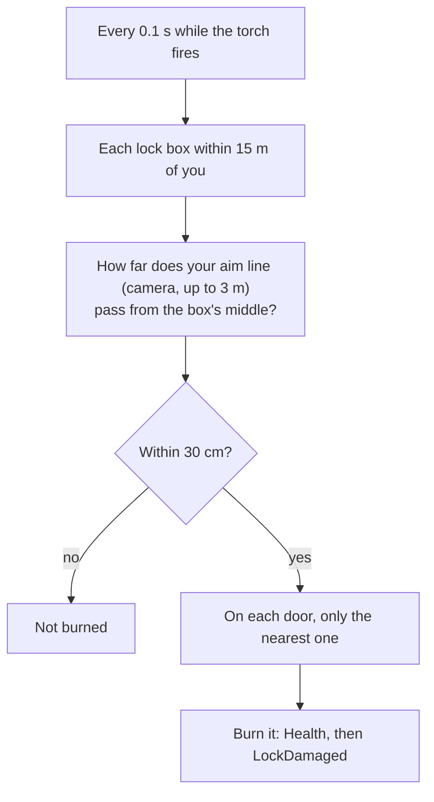
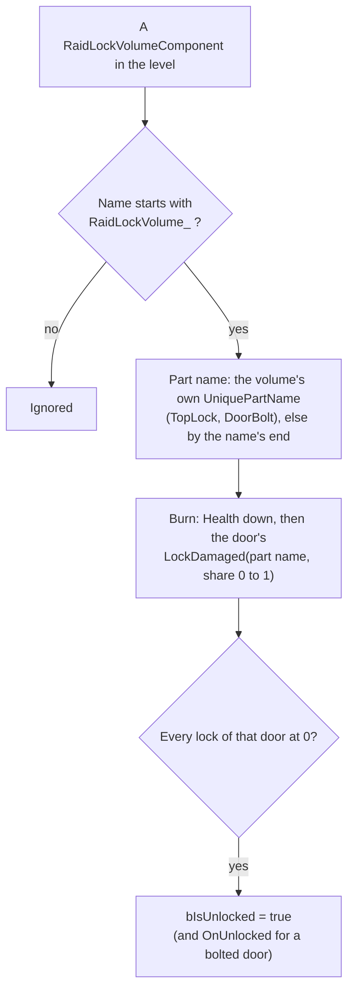
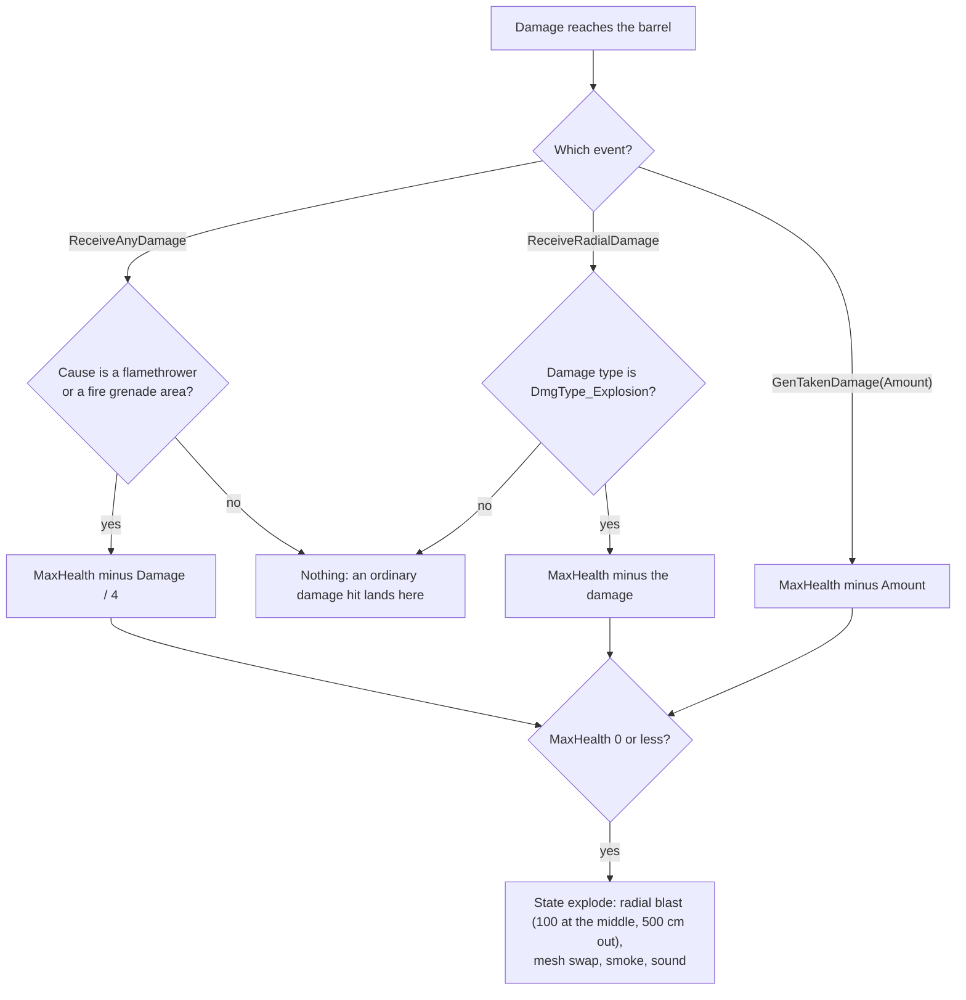

# The blowtorch offline: why it didn't open a vault, and what stands in for it

The vault door in a raid has three pieces of metal (a top, middle and bottom lock) that you burn through with the blowtorch.
Offline the torch lit up, made its noise and hurt soldiers, but the locks never changed and the door kept saying "F requires
blowtorch". `Scripts/blowtorch.lua` does the missing part. This page is how the pieces fit, so the next interaction like this
one (a tool, a door, a prop that reacts to a hit) can be worked out the same way.

## Who does what

- **The torch's Blueprint is cosmetic.** Decompiled with `tools/offline-audit/kdis.py` (2026-11-18): firing starts the sound,
  the flame particles and the light; stopping fades them. There is no damage code in it. The damage is native code
  (`RaidWeapon_Tool`, from `RaidWeapon_Instant`), which can't be read or changed from here.
- **The door has no damage code either.** It has three lock boxes (`RaidLockVolumeComponent`, a hidden box with a native
  `Health` of 300) and one event, `LockDamaged(LockName, HealthPercent)`. The native weapon code is what hits the boxes and
  calls that event.
- **Offline, that link is gone.** Soldiers still take the torch's damage, but the lock boxes never lose health, `LockDamaged`
  never runs, and the door stays locked. The mod can't repair the native part, so it plays its role: it burns the lock you
  aim at and calls the door's own event, so everything after that (glow, falling latch, the door opening) is the game's.

## One lock, start to finish

- **Timings.** At 100 damage a second a lock takes about 3 s of firing (the first test, on 2026-11-18, ran at 50 and took
  about 6 s; see "How fast" below). After a lock reaches 0 the door's own Blueprint waits `Delay(10)` and then scales the
  latch down over about 5 s; the vault door finished opening about 1 s after the last latch. That wait is the door's, not
  the mod's, and it looks like lag once the lock stops glowing, so the whole door still takes about 15 s after the last
  lock, however fast you burn.
- **The share is 0 to 1.** The door stored 0.9667 for a lock at 290 of 300. A percent from 0 to 100 would be wrong.
- **The mod sets `bIsUnlocked` itself** once all three locks are at 0. That is the flag "F requires blowtorch" checks.

## When the torch counts as firing

The torch fires in bursts: `BurstStartFireEvent` and `BurstStopedFireEvent` alternate about every 0.08 s (a new burst
about every 0.16 s), and `BurstCounter` is 0 between them even with the trigger held. The mod looks every 0.1 s, and the
first version burned nothing on a look that landed in a gap and reset its timer, so that time was thrown away: in the
2026-11-18 log the locks lost 40 to 45 health a second at a set rate of 50.

Now the torch counts as firing for 0.2 s after the last burst the mod saw (`GRACE`), and the whole time between looks is
credited, so held fire burns the full rate. The credit never runs past that window, so a tap does not burn on after you
let go.

## How fast

The rate comes from the torch's own data and from testers of the original game, not from the first guess:

- The torch's `WeaponConfig` has Damage 15 and a shot every 0.075 s (about 13 a second), 200 a second raw. The bursts are
  on about half the time, so about 100 a second lands. The earlier 50 came from guessing that its `DamageDivide` of 4 was
  applied to locks; nothing showed that, and it is withdrawn.
- Testers report about 3 s a lock in the original game, which is 100 a second on a 300 health lock.
- Fuel agrees. It drains about 13 a second while the trigger is held (250 to 0 in about 19 s in the log), and a vault is
  900 health, so 9 s and about 117 fuel held down. Testers who tap burn a whole vault use 90 to 100 fuel, because fuel
  only runs while a burst is firing.

## Which lock burns

- **Nearest to the aim line, not "inside the box".** The first version tested whether points on the aim were inside each lock
  box, and all three locks melted together. The boxes are small (about 14 by 7 by 11 cm either side of the middle) and the
  three sit about 60 cm apart in a column, so the nearest line is a clean way to pick exactly one.
- **A door's locks are told apart by name,** `RaidLockVolume_Top`, `_Middle`, `_Bottom`, and the owner of each box is its door.
- **State is per raid** (`raid.torch`), so a new map starts with all locks at full health. The boxes are looked for every
  10 s while firing, and only while firing (a `FindAllOf` walks every object).

## The other blowtorch doors: one bolt instead of three locks

The Spaceport vault is not the only door the torch opens. Reading the cooked Blueprints and the raid maps (2026-11-23) found
a second door class, and the lock code had to learn it.

| Door class | Where | Lock volumes (`UniquePartName`, Health) | Needs the torch |
|---|---|---|---|
| `Door_BlowTorch_C` | Spaceport vault (1 door) | `RaidLockVolume_Top / _Middle / _Bottom` (`TopLock`, `MiddleLock`, `BottomLock`, 300 each) | yes |
| `Door_BlowTorchReq01_C` | Merchant ship (2 doors: one beside a crate, one under the Chief Engineer's passcode door), Colony Cruiser (1 door, inside the vault) | `RaidLockVolume_DoorBolt` (`DoorBolt`, 500) | yes |
| `Door_CruiserVault_C` | Colony Cruiser vault entrance | none: an ordinary door (`Base_Door_C`) | no |
| `Door_LockedCE_C` and the other `Door_Locked*` | Merchant ship, Colony Cruiser, Spaceport | none: opened with an item (`CEPasscode` for the CE door) | no |

- **What was wrong.** The first version only knew the three vault names. A bolted door's volume is `RaidLockVolume_DoorBolt`,
  so it was skipped, nothing was burned, and the door kept saying "F requires blowtorch".
- **The "tag" is `UniquePartName`.** Each lock volume carries it, and it is exactly the name the door's `LockDamaged` switches
  on (`'TopLock'`, `'MiddleLock'`, `'BottomLock'` on the vault, `'DoorBolt'` on the bolted door). Anything else is ignored by
  the door, so the lock now takes the name from the volume instead of a fixed table.
- **A bolted door's own flow** (decompiled): `LockDamaged('DoorBolt', share)` stores the share, the bolt's material glows by it,
  at 0 the bolt breaks (sound, physics on), 10 s later it shrinks away, and the door swings open. `OnUnlocked` then reveals two
  broken pieces (`SM_DoorBroken01 / 02`). That event normally runs from the unlock's replication, which never happens offline,
  so the torch code calls it itself for a door that has those pieces. The vault door is left exactly as it was verified.
- **Health 500, so 10 s of torch.** At 50 damage a second the bolt takes ten seconds, the vault locks six.
- Not verified in game yet. `bridge/t_locks.lua` (copy it to `bridge/dir_eval.lua` in a raid) lists every lock volume with its
  `UniquePartName`, Health and door, to check the Lua side reads the same values as the pak.

## What it leaves alone: barrels and gas cans

The torch doesn't hurt explosive barrels or gas cans offline either. That is not fixed here, because it isn't known that the
real torch sets them off. What the barrel's Blueprint (`00_UA_Exploder_Base`, decompiled 2026-11-18) does with damage:

- A gas can has `MaxHealth` 10 and a barrel 42. Burning them with ordinary damage for several seconds, and with a hit of the
  explosion damage type, changed nothing (2026-11-18).
- `GenTakenDamage` is the one that looks like what a gun's hit calls. If the community confirms the real torch sets barrels
  off, calling it from the torch's burn loop is the likely fix, as a separate change.

## Where things are

| What | Where |
|---|---|
| The burn loop | `Scripts/blowtorch.lua` (`frame(pc)`, called from the director's per-frame section in `main.lua`) |
| Blowtorch in the F9 gun list | `Scripts/debuggive.lua` (`BlowTorch`, 250 charge) |
| The decompiler used | `tools/offline-audit/kdis.py` |
| Notes and test numbers | `NOTES.md`, "Blowtorch locks" |

## Trying it

Give yourself the torch from the F9 gun list, stand at a blowtorch door and burn the top, middle and bottom locks one at a
time: only the lock you aim at should glow and fall, each in about 3 s held down. When the last latch has fallen (about
15 s after the last lock) the vault door opens. A whole vault takes about 117 fuel held down, 90 to 100 tapping. It needs a
raid with a blowtorch vault door in it.
