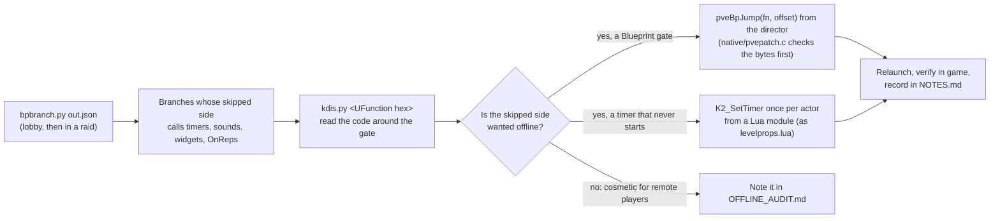

# offline-audit/: finding what the game skips when it's its own server

Offline the game is the authority: `IsServer()` and `HasAuthority()` are always true, and `OnRep_*` callbacks never
run because nothing replicates. Effects that the live game left to the client (sounds, timers, prompts, doors) quietly
don't happen. These tools find those spots by reading the game's code from the **running game's memory** (read-only;
start it offline first). OFFLINE_AUDIT.md is the list of what they found and what's fixed.

## The main tools

| Tool | Use |
|---|---|
| `bpbranch.py <out.json> [<out.txt>]` | Every loaded Blueprint's authority / net-mode branches, and what the never-run side does. Results add up across runs (only loaded Blueprints are scanned) |
| `kdis.py <UFunction hex> [from] [to]` | Kismet bytecode disassembler: one statement per line with offsets and names. Get the address with `scripts/send.sh "lua return string.format('%x', StaticFindObject('<path>'):GetAddress())"` |
| `bpauth.py`, `bpis.py`, `bpserver.py`, `bpseq.py`, `bpwin.py`, `bpfns.py`, `bpev.py` | Narrower views: where the checks are, each IsServer call with its jump, a function's references in order, how an AnimNotify enters the ubergraph |
| `onrep.py` | Native `OnRep_*` functions nobody calls besides replication (so they never run offline) |
| `gates.py`, `calls.py`, `scan.py`, `impl.py`, `names.py`, `objs.py`, `dis.py` | Native code: net-mode and Role compares in the exe, callers of an address, naming native functions |
| `fnames.py`, `strs.py` | Search the name pool / UTF-16 strings for text |
| `itemrows.py`, `itemsizes.py`, `gearrows.txt`, `voicerows.py`, `frigdata.py`, `hangar.py` | Data tables: items (writes `assets/saves/items.json`), gear, voice sets, ships |
| `approws.py`, `paknames.py` | Appearance rows with their meshes; every packed file's path from the decrypted pak index in memory (no pak key needed) |

Memory offsets (the name pool, `gbase`) are for the current game build; after a game update they need finding again.
Read-only does not mean safe to run blind: these read memory the game is using, so expect a wrong address to give
garbage, not a crash.
